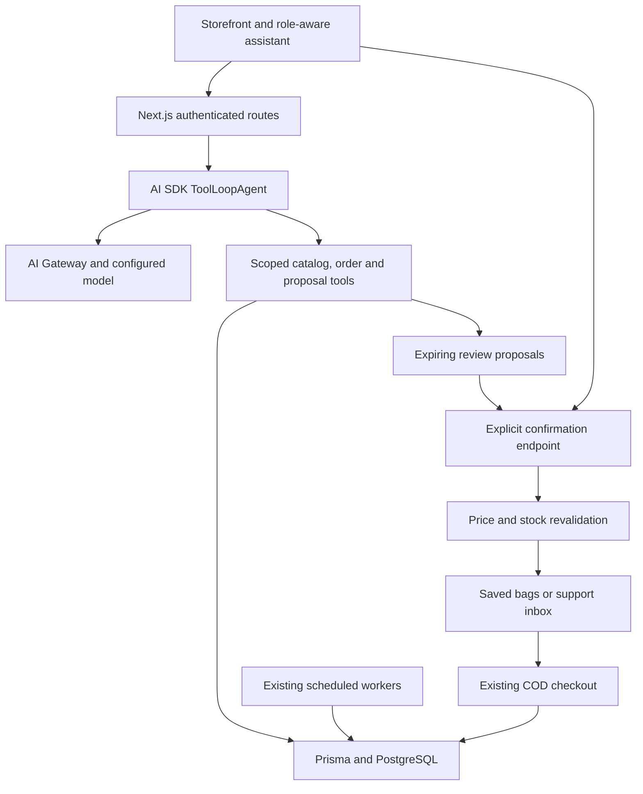

# Agentic FreshPick: implementation and next architecture

**29 October 2026 update:** [A2A quotations](A2A.md) add a deterministic A2A 1.0 skill, separate partner credentials, persisted tasks, follow-ups and durable retry receipts. MCP now uses a shared PostgreSQL quota and recognizes Vercel hostnames. See [Vercel deployment](VERCEL_DEPLOYMENT.md) and [Pages publishing](GITHUB_PAGES.md). Netlify schedules still require explicit Vercel adapters.

This repository starts from **FreshOnTime/newfreshontimewebsite**, pinned to commit `51a4bb811f78cfac5319fdd82c2d5de09e215559`. The storefront, assets, portals, orders, COD checkout, subscriptions, administration, migrations and public read-only MCP endpoint are retained. This is a code/assets copy, not a copy of the production database, uploaded Supabase objects, hosting settings or secrets. The original repository is not modified.

## Decision: extend the commerce application

Use a **modular Next.js application with one bounded tool-calling orchestrator**. Six workspaces select different authorized tools; they are not six autonomous services. Prisma/PostgreSQL remains authoritative. There is no need for a vector database, autonomous agent swarm, separate Python service or a new checkout stack at this stage.

AI SDK 7.0.155 is pinned in the lockfile. The implementation uses its bundled `ToolLoopAgent`, `tool`, `inputSchema`, `isStepCount` and `generate` contracts. Node 22+ is required. Model choice is configuration, not an unverified hardcoded model ID. See the [SDK agent documentation](https://ai-sdk.dev/docs/agents/building-agents) and [current Gateway model catalog](https://ai-gateway.vercel.sh/v1/models). The existing non-eve application is extended directly rather than introducing a separate runtime.

## What is implemented

| Workspace | Data and behavior | Execution boundary |
| --- | --- | --- |
| Shopping | Search live products and categories; inspect delivery rules; create a budget-checked proposal with real prices, discounts and stock | Customer confirms to create a saved bag. No reservation/order/payment until existing checkout |
| Producer | Approved suppliers search their own products, use a text brief or optional photo, and save listing copy with missing fields | Review-only. No automatic publishing, ingredient/allergen certification or inferred shelf life |
| Inventory | Authorized staff review the 100 lowest-stock products, minimum levels and optional `attributes.sellBy` dates | On demand, sampled recommendations. Not a complete expiry sweep, batch inventory system, forecast or scheduled monitor |
| B2B procurement | Catalog matching and a saved RFQ/procurement proposal with missing requirements | No supplier contact, negotiated prices, stock reservation, kg conversion without known pack sizes, binding PO or supplier response collection |
| Customer support | Read the customer's own recent orders/status; draft a support case | Customer explicitly submits to the existing enquiry inbox. No cancellations/refunds or live courier integration |
| Growth | Aggregate popular products over 30 days; count active email subscribers; save bundle/campaign copy | Draft-only. No customer contact lists, automatic replenishment, WhatsApp consent, audience dispatch or campaign sending |

Conversations persist across reloads and support follow-up requests. The server loads at most eight completed turns within a 24,000-character context budget, with compact historical proposal data. Older details may need to be restated. Prices, stock and order facts must be refreshed through live tools; prior confirmations do not authorize new actions. Drafts persist across reloads. A vision-capable configured model is required for producer photos (one image/request, 2 MB UI limit). Images are sent as validated data URLs, not fetched from arbitrary hosts. The optional photo is not stored in the application DB. AI text remains untrusted and must be reviewed.

## Data and permission boundaries

- Identity and primary/secondary roles come from the authenticated user in PostgreSQL. Client/model-supplied identity, supplier IDs and role escalation are not accepted.
- Customers receive shopping, procurement and support. Approved active supplier accounts receive producer tools; admins also receive producer tools. Admins/inventory managers receive inventory; admins/marketing specialists receive growth. Existing admin management pages may remain admin-only.
- Model tools never accept SQL, arbitrary URLs, credentials or payment actions. Sensitive tool sets are not registered in unauthorized workspaces. Order queries always include `customerId`; supplier catalog queries include the linked `supplierId`.
- All-in shopping budget is entered separately by the customer. The backend merges duplicate product IDs and uses integer pack quantities, authoritative discounted prices and delivery fees. Unknown pack size is explicitly unverified; catalog attributes need normalization before bulk kg conversion can be trusted.
- A basket proposal expires after 30 minutes. Confirmation checks owner, completed run, expiry, current stock and unchanged quoted prices/pack details/delivery. Changed quotes require another review. Saved bags do not reserve stock; checkout still validates fulfillment and stock transactionally.
- Confirmation runs in a serializable transaction, uses a PostgreSQL advisory lock per draft, stores a receipt and writes the audit log in the same transaction. A repeated confirmation returns the original result. Serialization conflicts return a retryable failure; a retry cannot create a second bag from the same draft.
- Customers may adjust pack quantities or remove products, then explicitly request a fresh quote. Repricing validates live stock/prices, delivery and the original budget, creates a new proposal and marks the original superseded in one transaction. The old proposal cannot be confirmed. Dismissed proposals also cannot execute. Repricing an expired basket is allowed; confirming an expired quote is not.
- Only basket and support drafts can execute. Producer/inventory/procurement/growth proposals must use existing management processes after review.
- Mutations require JSON and a same-origin or explicitly configured frontend origin. Private responses use `Cache-Control: private, no-store` and the existing service worker excludes APIs.

## Limits and records

`AgentConversation`: owner, workspace, title and timestamps. Only the owner with current workspace permission can list, resume or delete it.

`AgentRun`: owner, selected mode, status, timestamps, token counts, invoked tool names, conversation ID, request ID/fingerprint, budget and user/assistant text for new conversations. Images and full tool-call transcripts are not stored. Completed responses are replayed for an identical request ID, without consuming more inference or quota; mismatched ID reuse is rejected. One live turn is allowed per conversation. A run older than two minutes cannot finish or expose partial drafts.

`AgentDraft`: owner, run, kind, title, structured payload, status, expiry and confirmation receipt. Payloads may include customer-written support information. Runs/drafts currently use application-scoped owner IDs; account deletion must include these records when that workflow is implemented.

Per request: six model steps, at most 16 executed tools, 1,800 output tokens per generation step, one provider retry, 50-second abort deadline. Per account: 20 requests/hour, counted transactionally in PostgreSQL across app instances. Configure a global provider spend cap in AI Gateway as well; per-account limits do not protect against many separately registered accounts. Prompt injection instructions are defensive guidance, not proof of injection immunity; tool permissions and confirmation boundaries are the enforcement layer.

Conversation deletion immediately erases its user/assistant text and proposals. Completed saved bags and support cases remain. Minimal run receipts (including request hashes and usage) remain so deletion cannot bypass quotas or cause old requests to rerun. Deletion waits for active inference to finish.

Add a retention worker before broad launch: expire presentation state and purge failed/old runs and drafts according to the adopted privacy policy (suggested starting point: 30 days), keeping necessary audit receipts separately. Expiry currently prevents execution but does not delete rows. Host termination can leave `running` rows; they still consume quota and their drafts cannot execute. A future cleanup worker should mark stale runs failed.

## API and file map

| Path | Purpose |
| --- | --- |
| `/assistant` | Responsive customer/staff workspace and draft review |
| `GET /api/agentic` | Configured state, authorized modes, recent conversations and completed-run drafts |
| `POST /api/agentic` | `{requestId, conversationId?, mode, message, budget?, image?}`; UUID request ID required, budget mandatory for shopping |
| `POST /api/agentic/drafts/:id/confirm` | `{confirm: true}`; executes only an owned basket/support draft |
| `GET /api/agentic/conversations/:id` | Owned conversation and its latest 40 turns / 30 proposals |
| `DELETE /api/agentic/conversations/:id` | Delete owned conversation content; requires JSON content type and trusted origin |
| `PATCH /api/agentic/drafts/:id` | `{action: "dismiss"}` or `{action: "revise", items}`; positive integer quantities, omitted lines removed |
| `lib/agentic/conversations.ts` | Owned memory, bounded context, durable request receipts and thread serialization |
| `lib/agentic/contracts.ts` | Validated inputs, role policies and shared types |
| `lib/agentic/tools.ts` | Mode-specific, narrowly scoped business tools |
| `lib/agentic/service.ts` | Quotes, persistence, quota and transactional confirmation |
| `lib/agentic/http.ts` | Auth, origin checks, bounded body parsing and private responses |
| `prisma/migrations/20261028180000_agentic_commerce` and `20261028230000_agent_conversations` | Additive draft, conversation and retry-receipt schema |

## Development and staging

1. Use Node 22+, `npm ci`, a **separate staging PostgreSQL database**, and the existing `.env.example` commerce/auth/storage setup. Do not point experiments at the production database.
2. Apply `npm run db:migrate` before starting the new routes. Existing migrations are retained. Provision users/products through the existing setup; database contents and credentials were not copied.
3. Set `AI_GATEWAY_API_KEY` and `AGENT_MODEL` to an available tool-calling model from the Gateway catalog. Use a vision-capable model if photo drafts are wanted. Set `AGENTIC_ENABLED=true` only when staging configuration is ready. These are server-only environment variables.
4. Set `FRONTEND_URL`/site URL to the new deployment. Configure approved delivery pricing and service areas. Verify host support for a 60-second route; lower the deadline or use a background worker if the hosting plan cannot support it.
5. Run `npm run lint`, `npm run test:unit -- --runInBand`, `npm run test:agentic`, `npx tsc --noEmit` and `npm run build`.
6. Run existing isolated PostgreSQL checkout checks and built-server smoke checks in CI. Exercise real AI requests only with staging products/accounts and a controlled provider budget.

Acceptance: a customer requests a basket under Rs. 3,500, sees actual products and delivery, confirms once, sees exactly one saved bag, and uses existing COD checkout. Repeat with a price/stock change, another user's draft/order ID, expired draft, duplicate confirmation, pending supplier, unauthorized staff mode, provider timeout, missing delivery configuration and a malicious catalog instruction. Verify stock/discount/order invariants directly in staging PostgreSQL, including concurrent confirmations. Photos should yield questions for unverified allergens and shelf life.

## Build sequence from here

1. **Shopping pilot:** evaluate basket relevance, all-in budget adherence, refusal of unverified allergy claims, tool error recovery, latency, tokens and conversion to confirmed bags. Use 30–50 anonymized Sri Lankan shopping requests, including Sinhala/Tamil only after language evaluation. Pilot with a small opted-in customer group.
2. **Producer quality:** add normalized pack units, ingredients/allergens, verified origin and approval/version fields. Introduce editable proposals and explicit publisher approvals; scan uploads and evaluate photo descriptions. Preserve ownership checks in every supplier API.
3. **Inventory and procurement:** introduce inventory lots (received/sell-by/expiry), reservations, sales-velocity signals, suppliers' offers/lead times, RFQ lines, PO approvals and contractual quantity units. Use database transactions for commercial invariants, and an outbox/queue for external effects.
4. **Durable automation:** add persisted jobs with dedupe keys, retry/backoff, leases, dead-letter handling and human approval states. Begin with existing Netlify workers plus a PostgreSQL outbox; consider a durable workflow engine only when long-lived approvals, event fanout or throughput justify it. Scheduled waste alerts and replenishment must use verified data and consent.
5. **Growth and external commerce:** add channel-specific consent, suppression, frequency caps and campaign approval before email/WhatsApp dispatch. Keep current public MCP read-only. Evaluate authenticated external agent commerce separately, including protocol conformance, merchant eligibility and operational support; protocol implementation is not a promise of listing in an AI marketplace.

Keep payments, refunds, seller price changes and purchase orders behind deterministic application services and explicit approvals throughout. Extract services when measured load, team ownership or isolation requirements justify the operational cost.

## Conversation and basket acceptance checks

Start a shopping conversation, ask a follow-up such as “replace those bananas”, reload and resume it, then edit a quantity and recheck the total before confirming. Retry an unchanged request after a network error; its saved response must return without another model call. Try another customer’s conversation ID, a different workspace on the same conversation, two concurrent turns, reused request IDs with changed content, old/dismissed proposal confirmation and deletion during active inference. Delete a completed conversation and confirm its text/drafts are gone while saved bags/support cases and the hourly quota remain. Automated PostgreSQL CI covers these data and concurrency boundaries. Model relevance and browser interaction still require staging evaluation with a configured provider.
